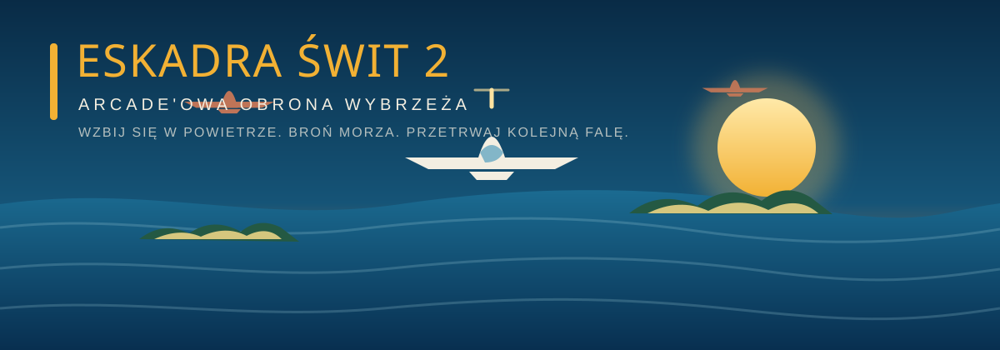

  

# Eskadra Świt 2

**Wskocz do kokpitu i broń wybrzeża przed kolejnymi falami wrogich samolotów.**
„Eskadra Świt 2” to lekka, zręcznościowa strzelanka lotnicza działająca bezpośrednio w przeglądarce. Nad błękitnym morzem, wyspami i falującymi chmurami czeka szybka misja: manewruj, unikaj ostrzału i zdobywaj punkty.

## Rozgrywka

Sterujesz myśliwcem, który automatycznie prowadzi ogień. Zestrzeliwuj nadlatujące maszyny, zbieraj złote gwiazdki i nie pozwól przeciwnikom przelecieć nad planszą. Co 15 zniszczonych samolotów rozpoczyna się kolejna fala — wrogowie nadlatują szybciej i robią się coraz groźniejsi.

Masz **trzy życia**. Po utracie ostatniego misja się kończy, ale możesz od razu wystartować ponownie i spróbować pobić swój rekord.

## Sterowanie

| Urządzenie | Sterowanie |
| --- | --- |
| Telefon lub tablet | Przesuwaj palcem po planszy. Ogień jest automatyczny. |
| Klawiatura | Poruszaj się strzałkami lub klawiszami **WASD**. |
| Mysz | Przesuwaj kursor po planszy. |

## Co czeka w grze?

- **Trzy typy przeciwników:** myśliwce, zygzakujące samoloty i wytrzymałe bombowce.
- **Coraz trudniejsze fale:** tempo i siła przeciwników rosną wraz z postępami.
- **Złoty bonus:** gwiazdka daje na 10 sekund podwójny ogień i dodatkowe punkty.
- **Rekord w przeglądarce:** najlepszy wynik zapisuje się lokalnie na urządzeniu.
- **Morze o świcie:** przewijająca się plansza, wyspy, chmury i dynamiczne efekty trafień.
- **Gra na różnych ekranach:** sterowanie dotykiem, myszą i klawiaturą; plansza dopasowuje się do rozmiaru okna.

## Uruchomienie

Gra nie wymaga instalacji ani procesu budowania. Otwórz plik **[Eskadra Swit 2.html](./Eskadra%20Swit%202.html)** w nowoczesnej przeglądarce i wybierz **Start**.

Możesz też opublikować plik jako stronę statyczną, na przykład przez GitHub Pages. Gra jest napisana w HTML, CSS i czystym JavaScripcie, a plansza jest rysowana na elemencie Canvas. Czcionki pobierane są z Google Fonts; w razie braku połączenia gra korzysta z krojów zastępczych.

## Pliki

- [`Eskadra Swit 2.html`](./Eskadra%20Swit%202.html) — cała gra: interfejs, sterowanie i logika rozgrywki.
- [`eskadra-swit-banner.svg`](./eskadra-swit-banner.svg) — ilustracja projektu.

---

**Miłego lotu i powodzenia w obronie wybrzeża!**
