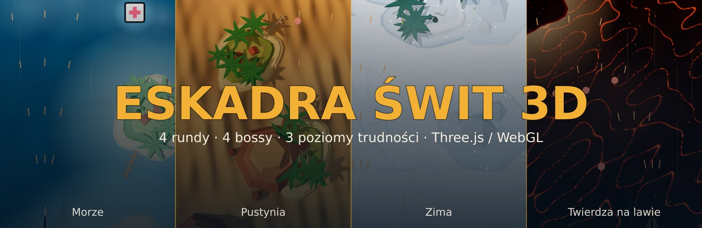
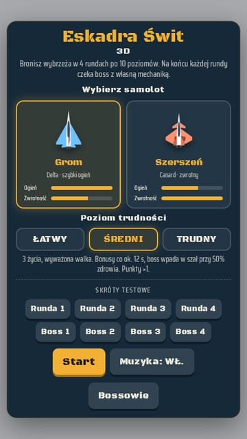
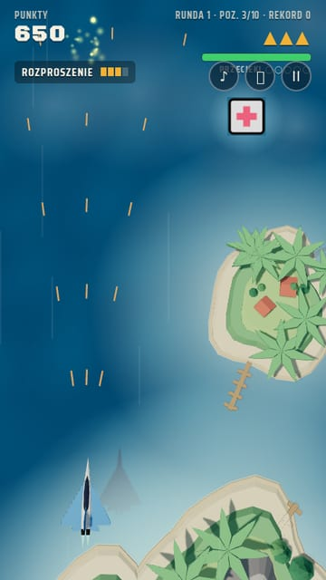
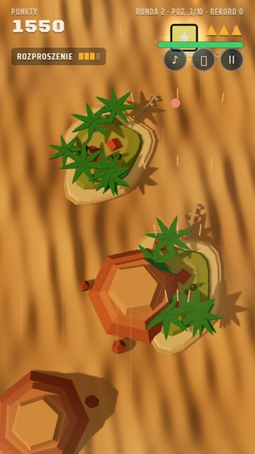
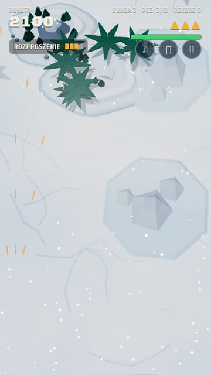
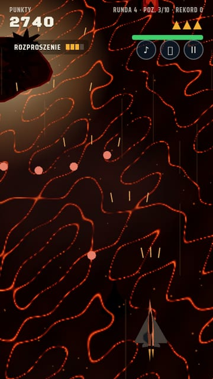
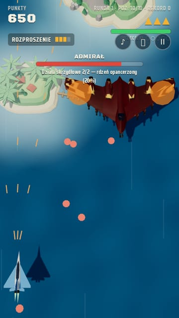
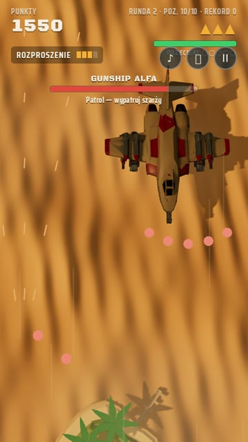
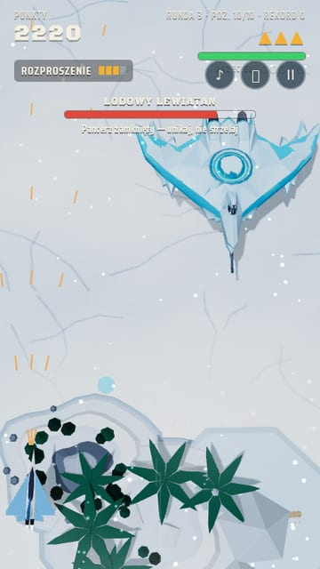
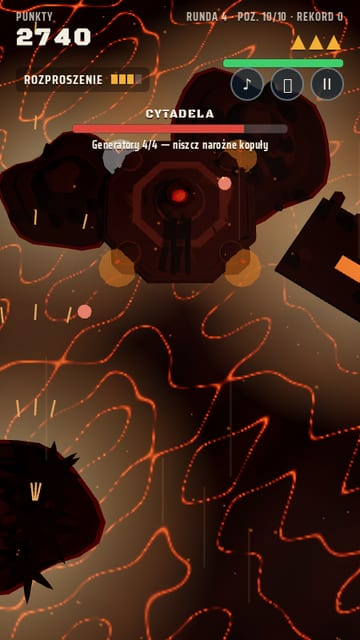

<div align="center">
  
</div>

# Eskadra Świt 3D

**Pionowa strzelanka 3D w przeglądarce (Three.js / WebGL).** Bronisz wybrzeża w **4 rundach po 10 poziomów**.
Każda runda ma inną mapę (morze, pustynia, zima, twierdza na lawie), innych wrogów i kończy się walką z bossem
o własnej mechanice. Pokonaj czwartego bossa, a gra kończy się ekranem „Gratulacje!”.
Sterowanie myszą, dotykiem lub klawiaturą, ogień automatyczny, pełny ekran, muzyka i efekty syntezowane w WebAudio.

| Menu | Runda 1 · Morze | Runda 2 · Pustynia | Runda 3 · Zima | Runda 4 · Twierdza |
|:---:|:---:|:---:|:---:|:---:|
|  |  |  |  |  |

## Rozgrywka

- **Rundy:** Morze → Pustynia → Zima → Twierdza na lawie. Każda ma własne podłoże, niebo, światło, scenerię i opady (śnieg, popiół).
- **Poziomy:** 10 w rundzie: 9 zwykłych i walka z bossem. Poziom ma skończoną liczbę wrogów, a trudność rośnie z poziomem i rundą.
- **Wrogowie:** myśliwiec, zygzak, bombowiec oraz w każdej rundzie jeden nowy: kamikadze (R1), śmigłowiec bojowy (R2),
  lodowy snajper ze spowalniającym pociskiem (R3). Runda 4 to wyłącznie wieże naziemne (działko, salwa, rakieta naprowadzana, bunkier).
- **Pasek życia:** pasek wytrzymałości jest na środku dołu ekranu. Na średnim poziomie trzy trafienia kończą jedno życie (łatwy: 4, trudny: 2),
  hitbox obejmuje kadłub razem ze skrzydłami. Pasek odnawia bonus „naprawa”, koniec poziomu (+15) i zmiana rundy.
- **Przełamanie obrony:** wróg, który przeleci dolną krawędzią, zapełnia licznik przecieków (5 na średnim, poziom ma własny licznik).
  Pełny licznik to „LINIA OBRONY PRZEŁAMANA”: −50 wytrzymałości, nawet przy włączonej tarczy (nie dotyczy rundy 4, gdzie wrogami są wieże).
- **Bonusy:** broń (4 poziomy), tarcza, naprawa, bomba, zegar, szybki ogień. Są rzadkie, 1UP daje tylko pokonany boss.
- **Punkty i rekordy:** osobny rekord dla każdego poziomu trudności, zapisywany w przeglądarce.

## Bossowie

W walce z bossem na ekranie jest **tylko boss** (bez innych przeciwników). Gracz i boss mają paski życia.
Boss nie zabija jednym trafieniem, a o połowie walki wypada bonus „naprawa”.

| Runda | Boss | Mechanika | Jak pokonać |
|---|---|---|---|
| 1 | **Admirał** | Rdzeń jest opancerzony (20% obrażeń), dopóki działają dwa działa na skrzydłach. | Zniszcz oba działa (pomarańczowe znaczniki), potem rdzeń. |
| 2 | **Gunship Alfa** | Czerwony pas ostrzega przed szarżą przez cały ekran. Po szarży boss jest przegrzany (×2 obrażeń). | Zjedź z pasa w bok, strzelaj w przegrzanego. |
| 3 | **Lodowy Lewiatan** | Pancerz na zmianę zamyka się (nietykalny) i otwiera (cyjan). Zamknięty strzela lodem i pierścieniem pocisków. | Unikaj pocisków, strzelaj tylko przy otwartym pancerzu. |
| 4 | **Cytadela** | Cztery generatory osłaniają rdzeń (im mniej ich, tym większe obrażenia); po zniszczeniu wszystkich odpala obrotowy laser. | Niszcz narożne kopuły, potem rdzeń; uciekaj z toru czerwonej linii. |

| Admirał | Gunship Alfa | Lodowy Lewiatan | Cytadela |
|:---:|:---:|:---:|:---:|
|  |  |  |  |

Opisy są też w grze: krótki na początku walki, pełny w menu pod przyciskiem **Bossowie**.

## Poziomy trudności

Wybór w menu (klik albo strzałki ↑/↓). Zmieniają liczbę żyć, obrażenia, HP i szybkostrzelność wrogów, prędkość pocisków,
liczebność fal, częstość bonusów, długość okien na bossach, moment szału bossa i mnożnik punktów.

| | Łatwy | Średni | Trudny |
|---|---|---|---|
| Życia na starcie | 5 | 3 | 2 |
| Trafień do utraty życia | 4 | 3 | 2 |
| Obrażenia gracza | ×0,75 | ×1 | ×1,5 |
| HP wrogów / bossów | ×0,8 / ×0,75 | ×1 | ×1,3 / ×1,3 |
| Punkty | ×0,75 | ×1 | ×1,5 |

## Sterowanie

| | |
|---|---|
| Mysz / dotyk | ruch samolotu, ogień automatyczny |
| Klawiatura | strzałki lub WASD; w menu ←/→ wybór samolotu, ↑/↓ poziom trudności |
| Esc / P | pauza i ustawienia |
| M / F | muzyka wł./wył. · pełny ekran |

W menu są **Skróty testowe**: start od dowolnej rundy albo prosto od walki z wybranym bossem (wynik nie trafia do rekordów).

## Uruchomienie

Gra używa modułów ES i plików `.glb`, więc potrzebny jest serwer HTTP (nie działa z `file://`):

```
python3 -m http.server 8000      # potem http://localhost:8000/
```

Three.js (r160), `GLTFLoader` i `BufferGeometryUtils` są w katalogu `vendor/`. Z internetu ładują się tylko czcionki Google Fonts.

## Struktura

```
index.html          cała gra: logika, render, audio (WebAudio), UI
vendor/             three.module.js, GLTFLoader.js, BufferGeometryUtils.js
models/             samoloty gracza i wrogów, wyspy (GLB, low-poly)
models/bosses/     modele bossów boss1..4_*_lite.glb (ok. 3 tys. trójkątów, tekstury 1024 px, ok. 450 KB każdy)
img/                sprity wyboru samolotu
sounds/             dźwięki z plików: wybuchy bossów, wybuch i pętla śmigłowca (reszta efektów jest syntezowana w kodzie)
docs/               grafiki do README (baner, zrzuty ekranu)
```

Mapy, nowi wrogowie (śmigłowiec, wieże) i efekty są budowane proceduralnie z brył Three.js. Podłoże każdej rundy to tekstura
generowana w kodzie (kolor + normalne, w rundzie 4 także emisja lawy). Ciężkie oryginały modeli bossów (`Runda … .glb`) są w `.gitignore`.

## Testy

Gra wystawia pomocnicze funkcje `window.__eskadra` (`symuluj`, `skocz`, `info`, `traf`…), używane w testach logiki
w headless Chromium (Playwright): symulacja walk bez renderowania w czasie rzeczywistym.
